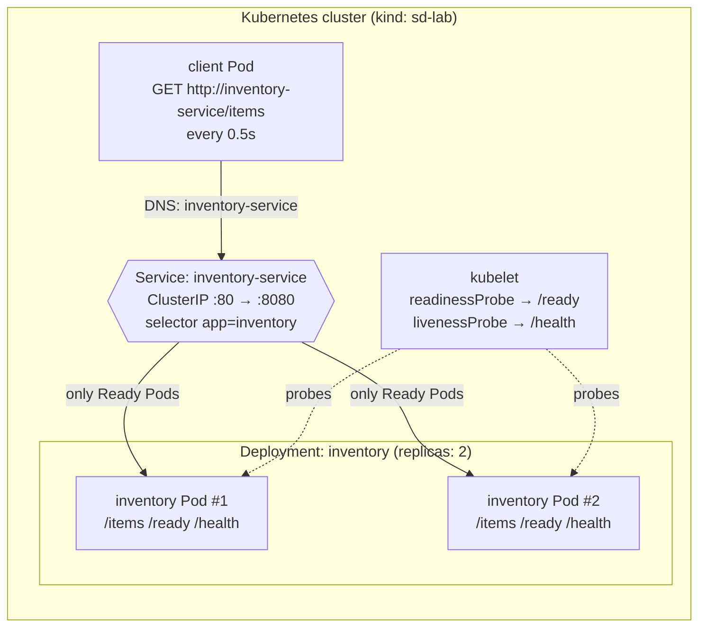
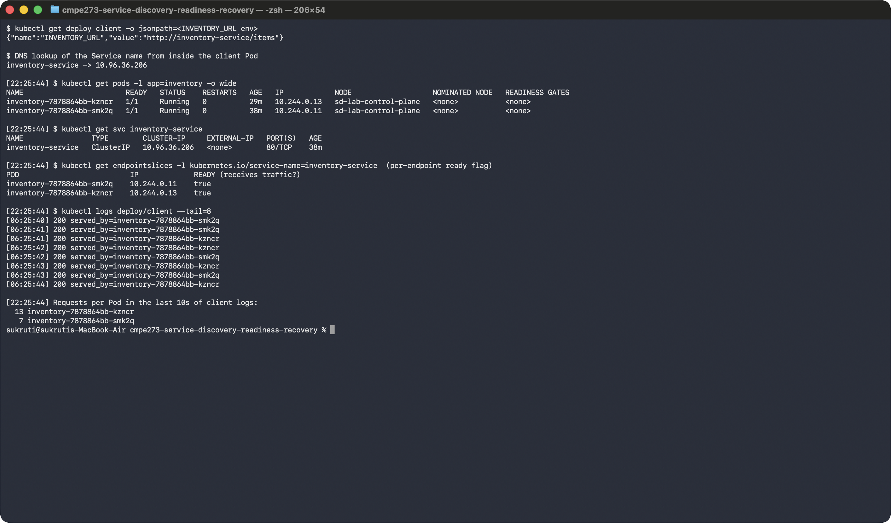
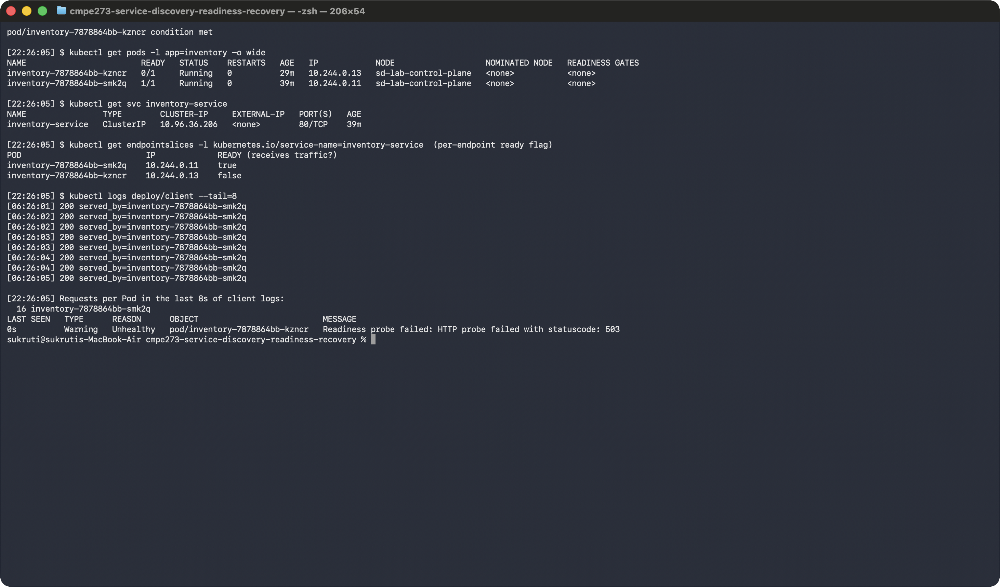
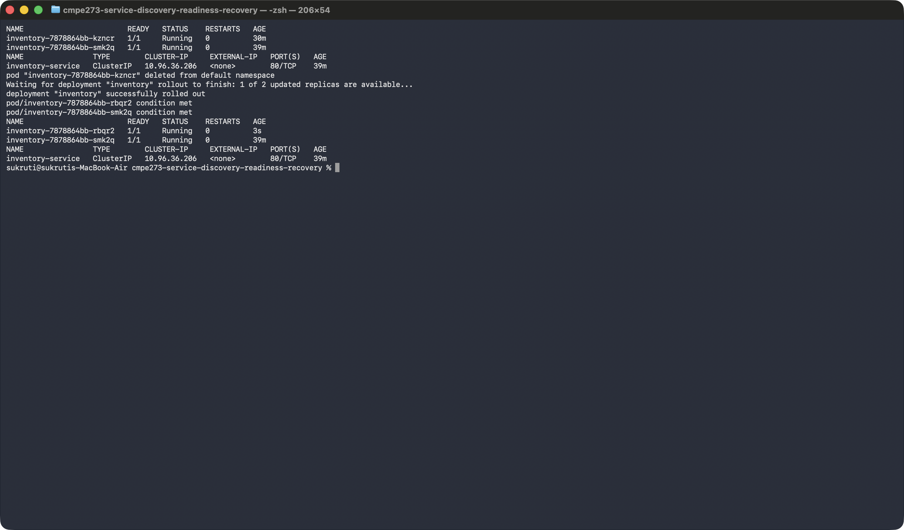
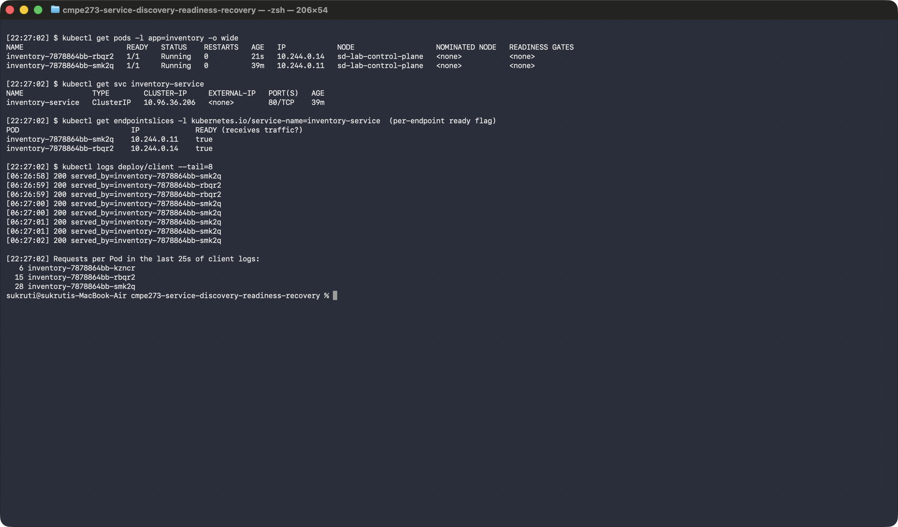

# CMPE 273 – Service Discovery, Readiness, and Pod Recovery on Kubernetes

A small Inventory Service runs on Kubernetes as **2 replicas** behind a **Service** named
`inventory-service`. A **client** Pod calls the Inventory Service once every 0.5s, using only the
Service name (`http://inventory-service/items`) and never a Pod IP. Each response includes the
name of the Pod that served it, so the logs show where every request went.

The scripts demonstrate three behaviors:
1. **Service discovery and load balancing:** requests reach both replicas.
2. **Readiness:** an unready Pod keeps running but stops receiving traffic, and gets traffic again once it is ready.
3. **Self-healing:** a deleted Pod is replaced by a new Pod with a new name, and the Service and client are unaffected.

Cluster: **kind** (Kubernetes in Docker) on macOS.

---

## Architecture



Plain-text version:

```
                         ┌──────────── Deployment: inventory (replicas=2) ───────────┐
 ┌────────────┐  DNS     │                                                           │
 │ client Pod │ ───────► │  Service: inventory-service ──► inventory Pod #1 (Ready)  │
 │            │ inventory│  (stable name + ClusterIP)  └─► inventory Pod #2 (Ready)  │
 └────────────┘ -service └───────────────────────────────────────────────────────────┘
                              ▲ routes only to Pods whose readiness probe passes
```

| Component | File | Purpose |
|---|---|---|
| Inventory app | `inventory/app.py` | `GET /items` returns stock plus `served_by` (Pod name). `GET /ready` returns 503 if `/tmp/unready` exists. `GET /health` always returns 200. |
| Client | `client/client.py` | Loops forever, calls the Service by name, logs `served_by` for each response. |
| Deployment | `k8s/inventory-deployment.yaml` | 2 replicas, a readiness probe on `/ready`, a liveness probe on `/health`. The Downward API injects `POD_NAME`. |
| Service | `k8s/inventory-service.yaml` | ClusterIP Service `inventory-service`, port 80 → 8080. |
| Client Deployment | `k8s/client-deployment.yaml` | `INVENTORY_URL=http://inventory-service/items` |

**Design notes**
- Readiness and liveness use **separate endpoints**. Failing readiness removes the Pod from the Service
  but never restarts it. Failing liveness would restart it.
- The readiness probe runs every 2s with `failureThreshold: 1`, so the demo responds within seconds.
- The client opens a **new connection per request**, so kube-proxy can choose a backend for each request.
  With keep-alive, a client would stay pinned to one Pod.
- Both apps handle `SIGTERM` and exit immediately, so a deleted Pod terminates in about 1s instead of
  waiting out the 30s grace period.

---

## Running it

### Prerequisites
- Docker Desktop (running)
- `kubectl`
- `kind` (`brew install kind`)

### Deploy
```bash
./scripts/setup.sh     # create kind cluster "sd-lab", build both images, load them into the cluster
./scripts/deploy.sh    # kubectl apply -f k8s/ and wait until all Pods are Ready
```

### Watch live (optional, macOS)
```bash
./scripts/live-view.sh # opens 2 Terminal windows: Pod status (-w) and live client logs
```
Or run these in two terminals yourself:
```bash
kubectl get pods -l app=inventory -o wide -w
kubectl logs -f deploy/client
```

### Capture the evidence screenshots (macOS)
```bash
./scripts/capture-screenshots.sh     # runs each scenario in a Terminal window and saves evidence/*.png
```
This needs Screen Recording permission for your terminal app (System Settings → Privacy & Security).

### Run the demos in the terminal (no screenshots)
```bash
./scripts/demo-1-load-balancing.sh   # both replicas receive traffic
./scripts/demo-2-readiness.sh        # readiness failure + recovery
./scripts/demo-3-pod-recovery.sh     # Pod deletion + replacement
./scripts/show.sh                    # one-screen status: Pods, Service, ready endpoints, recent requests
```

### Run manually without the scripts
```bash
kubectl exec <inventory-pod> -- touch /tmp/unready   # make a Pod fail readiness
kubectl exec <inventory-pod> -- rm /tmp/unready      # restore readiness
kubectl delete pod <inventory-pod>                   # delete a Pod, watch it get replaced
```

### Clean up
```bash
./scripts/cleanup.sh         # delete app resources
./scripts/cleanup.sh --all   # delete the whole kind cluster
```

---

## Evidence

All evidence is in the form of real Terminal screenshots in [`evidence/`](evidence/), captured in one run
by `./scripts/capture-screenshots.sh`.

### 1. Both replicas running, client uses the Service name, requests reach both replicas

- The client's only target is `INVENTORY_URL=http://inventory-service/items`.
- Inside the client Pod, the name `inventory-service` resolves to the Service ClusterIP `10.96.36.206`, not to a Pod IP.
- Both Pods (`kzncr`, `smk2q`) are `1/1 Running`, and both endpoints are `true`.
- Client logs show responses from **both** replicas: 13 and 7 requests in 10s.



### 2a. Readiness failure

`kubectl exec <pod> -- touch /tmp/unready` makes `/ready` return 503.

- `kzncr` is **`0/1` but still `Running`**, with `RESTARTS 0`, so the Pod was not killed.
- Its endpoint flips to **`false`**, so the Service stops routing to it.
- **All 16 requests** in the window went to the other ready Pod, `smk2q`.
- The event shows `Readiness probe failed: HTTP probe failed with statuscode: 503`.



### 2b. Readiness restored

`kubectl exec <pod> -- rm /tmp/unready`

- `kzncr` is back to `1/1`, and its endpoint is `true` again.
- It **receives traffic again**: 6 requests to `kzncr`, 10 to `smk2q`.


### 3a. Pod deleted, Kubernetes creates a replacement

- Before: Pods `kzncr` and `smk2q`.
- `kubectl delete pod inventory-7878864bb-kzncr`
- After: the Deployment created **`rbqr2`**, a new Pod with a different name (3s old). `smk2q` is untouched.
- `inventory-service` has the **same name and ClusterIP `10.96.36.206`** before and after.



### 3b. Client keeps communicating through the Service

- The new Pod `rbqr2` (IP `10.244.0.14`) is behind the same Service and receives traffic.
- Over the 25s window covering the deletion, every client request returned **200**: 6 from the deleted
  Pod `kzncr` before it went away, 15 from the new `rbqr2`, and 28 from `smk2q`. There were no errors.



> Timestamps: `[HH:MM:SS] $` prompts are local time (PST). Client log lines are UTC (+8h).

---

## Reflection

**Why is a stable Service name useful when Pods can fail or be replaced?**

Pods are temporary. When a pod fails or is replaced, replacement Pod comes with a new name and a new IP. But, the Service name and its ClusterIP stays identical, and Kubernetes keeps the list of Pods behind it up to date automatically. When a Pod fails readiness, it is removed from that list, and when a new or recovered Pod becomes Ready, it is added. As a result, a client never has to change configuration or retry against a new address and sees no errors, because it depends on a stable name rather than on any particular Pod.
